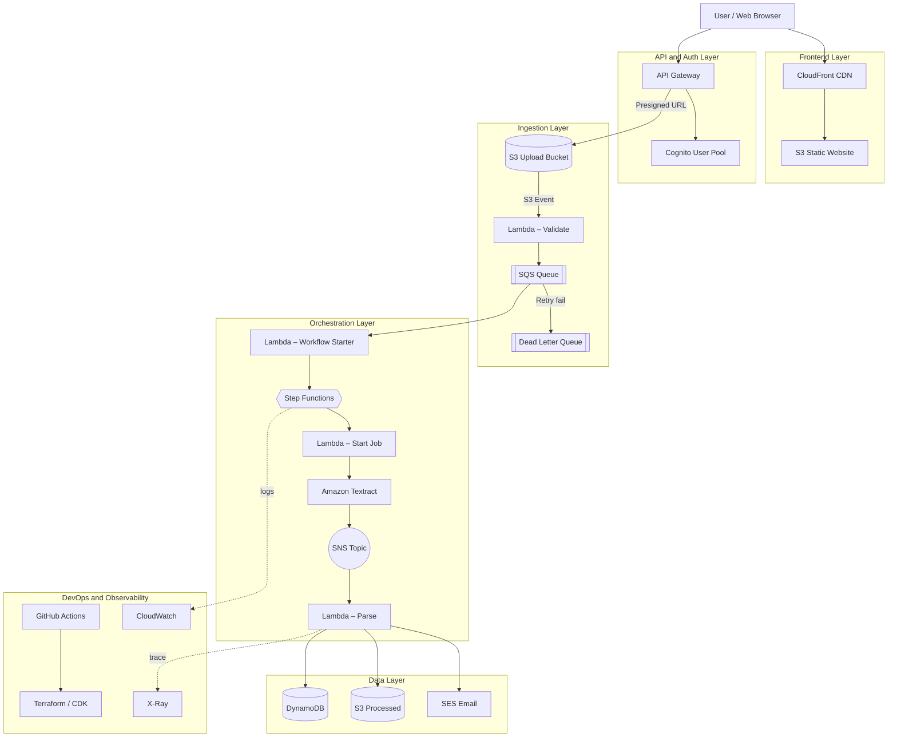

# idp-aws-pipeline

Hệ thống bóc tách hóa đơn / bảng điểm thông minh trên AWS - serverless, event-driven, có khả năng xử lý hàng nghìn tài liệu song song.

Đồ án môn **Điện toán đám mây** - Nhóm 6

---

## Tài liệu làm việc

- [Theo dõi tiến độ](PROGRESS.md)
- [Kế hoạch tổng thể](<đọc đi mấy tk bu đà.md>)
- [TV2: chạy local, AWS Academy và bàn giao](docs/tv2/README.md)
- [TV2: đối chiếu Bước 0–13](docs/tv2/IMPLEMENTATION_STATUS.md)

---

## Mô tả

Pipeline tự động nhận diện và trích xuất dữ liệu có cấu trúc từ file hóa đơn / bảng điểm scan (PDF, JPG, PNG), sử dụng **Amazon Textract** và kiến trúc serverless event-driven trên AWS.

Luồng xử lý chính:

```
Upload file → S3 → Lambda Validate → SQS → Workflow Starter → Step Functions → Textract (async) → Parse → DynamoDB + Email
```

---

## Kiến trúc hệ thống



---

## Công nghệ sử dụng

Phần TV2 có mã và test local. Hạ tầng `infra/tv2-dev` hiện là cấu hình chưa deploy;
workflow mock TV2 chỉ kiểm tra nhận input, không chứng minh OCR end-to-end.
Xem trạng thái từng bước trong tài liệu TV2 trước khi sử dụng trên AWS Academy.

| Lớp               | Dịch vụ AWS                                          |
| ------------------ | ------------------------------------------------------ |
| Frontend & Hosting | S3 Static Website, CloudFront, AWS Certificate Manager |
| Auth & API         | Cognito User Pool, API Gateway, IAM                    |
| Ingestion          | S3, Lambda, SQS, Dead Letter Queue                     |
| Orchestration      | Step Functions, SNS                                    |
| AI / OCR           | Amazon Textract (Async API)                            |
| Data               | DynamoDB, S3                                           |
| Notification       | Amazon SES                                             |
| DevOps             | Terraform, GitHub Actions, CloudWatch, X-Ray           |

---

## Phân công nhiệm vụ

| Thành viên   | Vai trò             | Phụ trách chính                                                                              |
| -------------- | -------------------- | ----------------------------------------------------------------------------------------------- |
| Thành viên 1 | Frontend & Auth      | S3 Static Hosting, CloudFront, Cognito, Lambda sinh presigned URL, IAM/CORS, IaC phần frontend |
| Thành viên 2 | Ingestion & Queue    | S3 Event, Lambda Validate, SQS, Dead Letter Queue, cơ chế retry                               |
| Thành viên 3 | Core OCR / AI        | Textract async API, SNS callback, Lambda Parse, xử lý JSON kết quả                          |
| Thành viên 4 | Data & Orchestration | Step Functions state machine, DynamoDB schema + GSI, S3 Processed, SES                          |
| Thành viên 5 | DevOps & Infra       | Terraform/CDK toàn bộ hạ tầng, GitHub Actions CI/CD, CloudWatch Alarms, X-Ray               |

---

## Cấu trúc thư mục

```
idp-aws-pipeline/
├── frontend/               # Giao diện web (S3 + CloudFront)
├── lambdas/
│   ├── validate/           # Kiểm tra file đầu vào
│   ├── workflow-starter/   # SQS → Standard Step Functions (TV2)
│   ├── start-job/          # Gọi Textract async
│   └── parse/              # Xử lý kết quả Textract
├── infra/                  # Terraform / CDK
│   └── step_functions/     # Định nghĩa state machine (ASL JSON)
├── tests/                  # Unit test cho từng Lambda
├── scripts/                # Build ZIP, preflight và smoke test TV2
├── requirements-dev.txt    # Dependency local đã khóa phiên bản
├── docs/                   # Tài liệu kỹ thuật chi tiết
│   ├── flows/              # Sequence diagram từng luồng xử lý
│   │   ├── upload-flow.md
│   │   ├── textract-async-flow.md
│   │   └── error-handling-flow.md
│   └── data-model.md       # DynamoDB schema + cấu trúc JSON Textract
└── README.md
```
