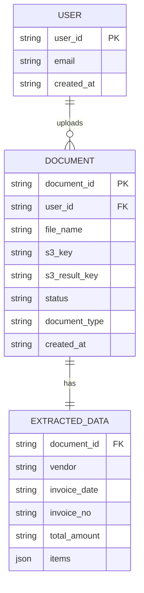

# Data Model

Mô tả cấu trúc dữ liệu trong hệ thống: DynamoDB table design và cấu trúc JSON Textract trả về.

Các ví dụ metadata, số tiền/số lượng và response bên dưới là dữ liệu tự dựng để minh họa schema;
không phải hóa đơn thật hoặc kết quả Textract đã được kiểm chứng trên AWS.

---

## DynamoDB Table Design

Bảng **Documents** lưu metadata/kết quả từng tài liệu theo PK/SK dưới đây.
PROGRESS còn có bảng **JobCallbacks** do TV4 thiết kế riêng; phần TV2 chỉ truy cập Documents.
Contract triển khai TV2 nằm ở [tv2/CONTRACT.md](tv2/CONTRACT.md), cần xác nhận khi ghép TV1/TV4.

### Cấu trúc Primary Key

| Attribute | Loại | Mô tả |
|---|---|---|
| `PK` (Partition Key) | String | `USER#<user_id>` |
| `SK` (Sort Key) | String | `DOC#<document_id>` |

### Các trường dữ liệu

```
{
  "PK":            "USER#abc123",
  "SK":            "DOC#doc-uuid-xxxx",
  "document_id":   "doc-uuid-xxxx",
  "user_id":       "abc123",
  "file_name":     "hoa-don-vinamilk-01-2024.pdf",
  "s3_key":        "uploads/abc123/doc-uuid-xxxx/hoa-don-vinamilk-01-2024.pdf",
  "s3_result_key": "processed/abc123/hoa-don-vinamilk.json",
  "status":        "SUCCEEDED",           ← UPLOAD_PENDING | QUEUED | PROCESSING | SUCCEEDED | NEEDS_REVIEW | FAILED | REJECTED
  "document_type": "INVOICE",             ← INVOICE | TRANSCRIPT
  "created_at":    "2024-01-15T08:30:00Z",
  "updated_at":    "2024-01-15T08:31:45Z",

  "extracted": {
    "vendor":        "Công ty Vinamilk",
    "invoice_date":  "2024-01-10",
    "invoice_no":    "HD-2024-00123",
    "total_amount":  "15,400,000",
    "currency":      "VND",
    "items": [
      { "description": "Sữa tươi tiệt trùng", "qty": "100", "unit_price": "30,000", "amount": "3,000,000" },
      { "description": "Sữa đặc Ông Thọ",     "qty": "240", "unit_price": "52,000", "amount": "12,400,000" }
    ]
  }
}
```

> **Tại sao không lưu raw JSON Textract vào DynamoDB?** DynamoDB giới hạn item size tối đa 400 KB. Raw JSON của Textract cho file nhiều trang có thể vượt 1–5 MB. Giải pháp: lưu raw JSON vào S3, chỉ lưu `s3_result_key` (đường dẫn trỏ tới S3) vào DynamoDB.

---

### Global Secondary Index (GSI)

GSI cho phép query theo chiều khác ngoài PK/SK.

| GSI | Partition Key | Sort Key | Mục đích |
|---|---|---|---|
| `GSI-status` | `status` | `created_at` | Lấy danh sách document theo trạng thái (UPLOAD_PENDING/QUEUED/FAILED...) |
| `GSI-type` | `document_type` | `created_at` | Lọc riêng hóa đơn hoặc bảng điểm |

---

## Cấu trúc JSON Textract trả về

Textract trả về một danh sách các **Block** — mỗi Block là một đơn vị nhận diện (dòng chữ, từ, ô bảng, cặp key-value...).

### Các loại Block chính

```
Block types trong response:
├── PAGE          → Toàn bộ trang
├── LINE          → Một dòng chữ (vd: "Công ty Vinamilk")
├── WORD          → Một từ (vd: "Vinamilk")
├── KEY_VALUE_SET → Cặp key-value (vd: "Tổng tiền:" → "15,400,000")
└── TABLE         → Bảng
    ├── CELL      → Ô trong bảng
    └── WORD      → Nội dung trong ô
```

### Ví dụ minh họa response (dữ liệu tự dựng, rút gọn)

```json
{
  "Blocks": [
    {
      "BlockType": "KEY_VALUE_SET",
      "EntityTypes": ["KEY"],
      "Text": "Tổng tiền:",
      "Id": "key-block-id-001",
      "Relationships": [
        { "Type": "VALUE", "Ids": ["value-block-id-001"] }
      ]
    },
    {
      "BlockType": "KEY_VALUE_SET",
      "EntityTypes": ["VALUE"],
      "Text": "15,400,000",
      "Id": "value-block-id-001"
    },
    {
      "BlockType": "TABLE",
      "Id": "table-block-id-001",
      "Relationships": [
        { "Type": "CHILD", "Ids": ["cell-001", "cell-002", "cell-003"] }
      ]
    }
  ]
}
```

### Logic parse trong Lambda Parse

```
Lambda Parse làm gì với JSON trên:
1. Duyệt qua tất cả Block có BlockType = KEY_VALUE_SET
2. Map KEY block với VALUE block qua Relationships
3. Tạo dict: { "Tổng tiền:": "15,400,000", "Ngày:": "2024-01-10", ... }
4. Normalize tên field (bỏ dấu, lowercase) → { "tong_tien": "15400000", ... }
5. Duyệt qua TABLE blocks → trích xuất từng hàng thành list items
6. Lưu kết quả vào DynamoDB (extracted fields) + S3 (raw JSON)
```

---

## Sơ đồ quan hệ dữ liệu



> Diagram minh họa quan hệ logic, không phải xác nhận có ba bảng vật lý.
> TV2 dùng bảng Documents; thiết kế USER/EXTRACTED_DATA/JobCallbacks và GSI thuộc TV1/TV4.
