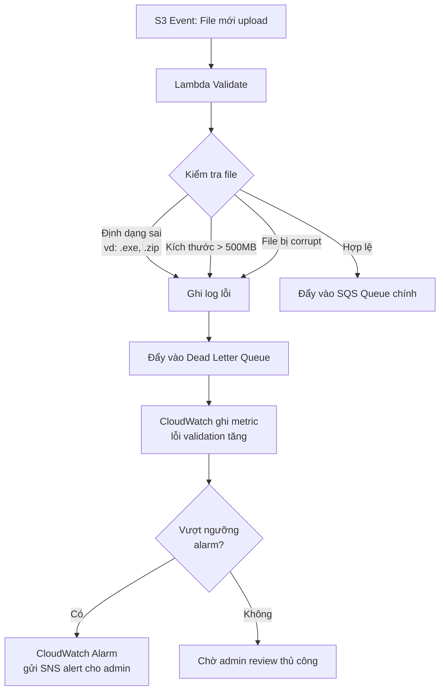
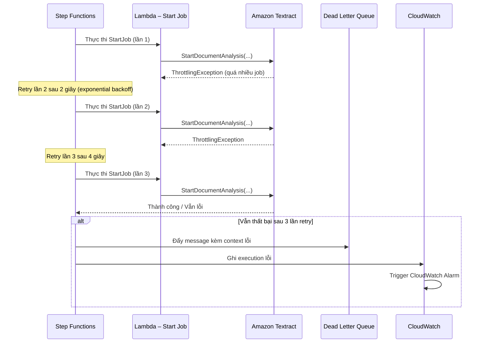
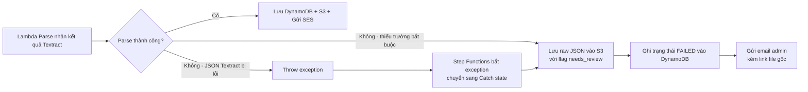

# Luồng Xử lý Lỗi

Mô tả cách hệ thống xử lý các trường hợp lỗi ở từng bước trong pipeline — từ file không hợp lệ đến Textract thất bại.

> Một hệ thống chuyên nghiệp không chỉ hoạt động được ở "happy path" mà phải xử lý được lỗi một cách có kiểm soát, không làm mất dữ liệu.

---

## Các loại lỗi và cách xử lý

### Loại 1 — File không hợp lệ (Lambda Validate)



---

### Loại 2 — Textract thất bại (Step Functions retry)



---

### Loại 3 — Parse thất bại (Textract trả kết quả không đọc được)



---

## Bảng tóm tắt chiến lược xử lý lỗi

| Loại lỗi | Nơi xảy ra | Chiến lược | Hành động |
|---|---|---|---|
| File sai định dạng / kích thước | Lambda Validate | Fail fast | Đẩy DLQ, ghi log |
| Throttling từ Textract | Step Functions | Retry + exponential backoff | Tối đa 3 lần, sau đó DLQ |
| Textract job FAILED | SNS → Lambda Parse | Catch và escalate | Ghi DynamoDB, alert admin |
| Parse không đọc được trường | Lambda Parse | Degrade gracefully | Lưu raw JSON, flag manual review |
| Lambda timeout | Step Functions | Catch state | Đẩy DLQ, CloudWatch Alarm |

---

## Dead Letter Queue — "Phòng cách ly" file lỗi

DLQ không phải thùng rác — đây là nơi lưu tạm **có thể xử lý lại** sau:

```
DLQ message chứa:
- s3_key: đường dẫn file gốc
- error_reason: lý do thất bại
- retry_count: đã thử bao nhiêu lần
- timestamp: thời điểm lỗi
```

Admin có thể vào DLQ, kiểm tra message, sửa vấn đề (ví dụ: tăng quota Textract) rồi **redrive** (đẩy lại vào queue chính) mà không cần người dùng upload lại file.
