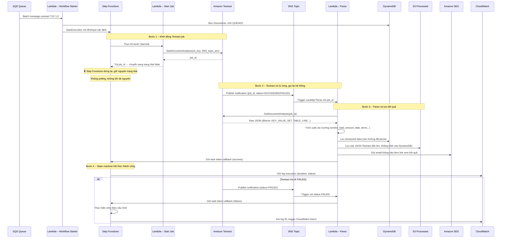

# Luồng Xử lý Textract Async

Mô tả chi tiết luồng từ khi message ra khỏi SQS đến khi kết quả được lưu vào database và người dùng nhận email thông báo.

> Đây là phần phức tạp nhất của pipeline và hay bị hỏi nhất trong vấn đáp. Điểm mấu chốt: Textract **không trả kết quả ngay** (async) — hệ thống dùng SNS callback thay vì polling mỗi giây.

---

## Sequence Diagram



---

## Tại sao dùng Async API thay vì Sync API?

| | Sync (`AnalyzeDocument`) | Async (`StartDocumentAnalysis`) |
|---|---|---|
| **Giới hạn trang** | PDF/TIFF tối đa 1 trang | PDF/TIFF tối đa 3.000 trang |
| **Kích thước file** | Tối đa 10 MB | JPEG/PNG 10 MB; PDF/TIFF 500 MB |
| **Thời gian chờ** | Lambda phải chờ trong suốt quá trình | Lambda trả về ngay sau khi gửi job |
| **Chi phí** | Trả per-page, block Lambda | Hiệu quả hơn cho file nhiều trang |
| **Phù hợp** | Demo đơn giản, 1 trang | Production, file thực tế |

---

## Vai trò của Step Functions

TV2 áp dụng giới hạn demo 10 MiB cho PDF/JPG/PNG; giới hạn Textract tham khảo
[tài liệu AWS](https://docs.aws.amazon.com/textract/latest/dg/limits-document.html).
Luồng callback/parser do TV3/TV4 hiện thực; workflow mock TV2 không thực hiện các bước này.

Step Functions giữ **trạng thái** của toàn bộ pipeline qua các bước:

```
[Start] → StartJob → WaitForCallback → ParseResult → [End]
                           ↑
                    SNS callback làm
                    State machine tiếp tục
```

Nếu không có Step Functions và dùng Lambda gọi nhau trực tiếp:
- Khi Lambda B timeout không ai biết pipeline đang ở bước nào
- Không có retry tự động
- Không có log từng bước để debug
