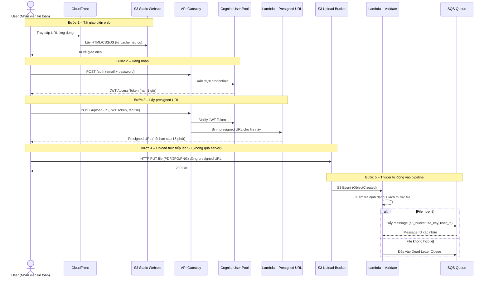

# Luồng Upload File

Mô tả chi tiết luồng từ khi người dùng truy cập giao diện đến khi file được đưa vào hàng đợi xử lý.

> Diagram tổng quan ở README chỉ thể hiện *ai kết nối với ai*. Diagram này thể hiện *thứ tự thời gian* và *dữ liệu truyền qua từng bước*.

---

## Sequence Diagram

---

## Giải thích các quyết định thiết kế

| Quyết định | Lý do |
|---|---|
| **Presigned URL thay vì upload qua Lambda** | Lambda phải đọc toàn bộ file vào RAM nếu làm proxy → chậm, tốn tiền. Presigned URL cho phép client upload thẳng lên S3, Lambda chỉ tạo link rồi "ngủ" |
| **CloudFront đứng trước S3 Static** | Cache file tĩnh tại edge server gần người dùng nhất, giảm latency và chi phí băng thông S3 |
| **SQS thay vì Lambda gọi thẳng** | Buffer chống tải đột biến: 500 người upload cùng lúc → 500 message vào queue, Lambda consume từng batch thay vì 500 Lambda chạy song song |
| **Lambda Validate trước SQS** | Lọc file rác sớm, không để file không hợp lệ chiếm chỗ trong queue và lãng phí Textract credit |
